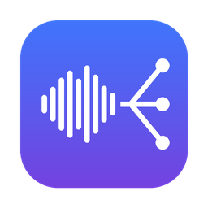
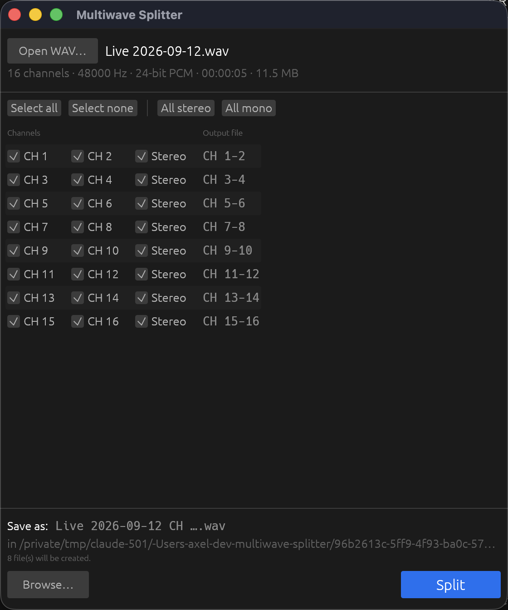

<p align="center">
  
</p>

<h1 align="center">Multiwave Splitter</h1>

<p align="center">
  Split multichannel WAV recordings into separate stereo and mono WAV files.<br>
  Small, fast, bit-exact. Free and open source (GPLv3). macOS, Windows and Linux.
</p>

<p align="center">
  <a href="https://github.com/axelsharper/multiwave-splitter/releases/latest/download/MultiwaveSplitter-macOS.dmg"><b>⬇ Download for macOS</b></a> ·
  <a href="https://github.com/axelsharper/multiwave-splitter/releases/latest/download/MultiwaveSplitter-Windows-Setup.exe"><b>⬇ Download for Windows</b></a> ·
  <a href="https://github.com/axelsharper/multiwave-splitter/releases/latest/download/MultiwaveSplitter-Linux-x86_64.tar.gz"><b>⬇ Download for Linux</b></a>
</p>

<p align="center">
  
</p>

Recorded a gig on a digital mixer (X32/Wing/SQ/dLive, Zoom, Sound Devices, a DAW export…) and got
one huge 16/32/64-channel WAV? Open it in Multiwave Splitter, tick the channels you want, choose
stereo or mono per channel pair, press **Split**. Done.

## Features

- Pick which channels to export with checkboxes.
- Channels are shown in pairs (1-2, 3-4, …). **Stereo** is ticked by default and turns the pair into
  one stereo file. Untick it to get two mono files instead. Selecting only one channel of a pair
  gives a mono file.
- Clear file names: `Show.wav` → `Show CH 1-2.wav`, `Show CH 3.wav`, `Show CH 4.wav` …
- By default the files are saved next to the original with the same name. Use **Browse…** to pick
  another folder or base name.
- **Bit-exact**: samples are copied, never converted or re-encoded.
- Handles 8/16/24/32-bit PCM and 32/64-bit float, `WAVE_FORMAT_EXTENSIBLE`,
  and files over 4 GB (RF64/BW64 in and out).
- Recovers audio from recordings that were interrupted (e.g. power loss) and have a broken header.
- Fast: one streaming pass over the file, all outputs are written at the same time. Progress bar and
  cancel. Existing files are only replaced after the split has finished successfully, and the app
  asks before overwriting.
- Drag and drop a file onto the window.
- A single self-contained program (~9 MB). No runtime, no dependencies.

## Installation

### macOS (Apple Silicon and Intel)

1. Download **[MultiwaveSplitter-macOS.dmg](https://github.com/axelsharper/multiwave-splitter/releases/latest/download/MultiwaveSplitter-macOS.dmg)**.
2. Open the DMG and drag **Multiwave Splitter** to **Applications**.
3. First launch: the app is not yet signed with an Apple Developer ID, so macOS will say it
   "cannot verify" the app. Do this once:
   - Try to open the app, click **Done**/**OK** in the warning.
   - Open **System Settings → Privacy & Security**, scroll down and click **Open Anyway** next to
     "Multiwave Splitter was blocked". Confirm with your password.

   Or, in Terminal:

   ```bash
   xattr -dr com.apple.quarantine "/Applications/Multiwave Splitter.app"
   ```

### Windows (10/11, 64-bit)

1. Download **[MultiwaveSplitter-Windows-Setup.exe](https://github.com/axelsharper/multiwave-splitter/releases/latest/download/MultiwaveSplitter-Windows-Setup.exe)** and run it.
   By default it installs for your user only, so no administrator rights are needed.
2. Windows SmartScreen may warn about an unknown publisher (the installer is not code-signed yet).
   Click **More info → Run anyway**.

Prefer no installer? Download the
**[portable zip](https://github.com/axelsharper/multiwave-splitter/releases/latest/download/MultiwaveSplitter-Windows-Portable.zip)**,
unzip it anywhere and run `MultiwaveSplitter.exe`.

### Linux (x86_64)

```bash
curl -LO https://github.com/axelsharper/multiwave-splitter/releases/latest/download/MultiwaveSplitter-Linux-x86_64.tar.gz
tar xzf MultiwaveSplitter-Linux-x86_64.tar.gz
cd MultiwaveSplitter-Linux-x86_64 && ./install-linux.sh
```

This installs to `~/.local` (no root) and adds a menu entry. Remove it again with
`./install-linux.sh --uninstall`. You can also just run `./multiwave-splitter` directly.
File dialogs use the desktop portal (`xdg-desktop-portal`), which is standard on GNOME, KDE and
most other desktops.

All downloads are also listed on the [Releases page](https://github.com/axelsharper/multiwave-splitter/releases).

## How to use

1. Click **Open WAV…** (or drop a file on the window).
2. Tick the channels you want. Use **Select all / Select none** and **All stereo / All mono** for
   speed. The *Output file* column shows exactly which files will be created.
3. Optional: click **Browse…** to choose another output folder or base name.
4. Click **Split**.

## Building from source

Install [Rust](https://rustup.rs) (stable), then:

```bash
git clone https://github.com/axelsharper/multiwave-splitter.git
cd multiwave-splitter
cargo run --release
```

On Linux you may need a few development packages first:
`sudo apt install libxkbcommon-dev libxcb-render0-dev libxcb-shape0-dev libxcb-xfixes0-dev`.

Packaging:

| Platform | Command | Output |
|---|---|---|
| macOS | `scripts/bundle-macos.sh` | `dist/MultiwaveSplitter-macOS.dmg` (universal) |
| Windows | `cargo build --release` then `iscc /DAppVersion=x.y.z installer\windows.iss` ([Inno Setup](https://jrsoftware.org/isinfo.php)) | `dist/MultiwaveSplitter-Windows-Setup.exe` |
| Linux | `scripts/package-linux.sh` | `dist/MultiwaveSplitter-Linux-<arch>.tar.gz` |

Releases are built automatically by GitHub Actions for all three platforms when a version tag is
pushed:

```bash
git tag v0.2.0 && git push origin v0.2.0
```

Remember to bump `version` in `Cargo.toml` first.

Run the tests with `cargo test`. They cover the WAV parser/writer, the channel planning, a bit-exact
split, cancellation, and a UI test that clicks through the whole app.

### Project layout

```
src/wav.rs      WAV/RF64 reader and streaming writer (no external audio libraries)
src/split.rs    Output planning (pairs, stereo/mono, file names) and the split itself
src/main.rs     GUI (egui/eframe)
examples/       Headless command line split, used for testing
installer/      Windows installer script, Linux .desktop file and install script
scripts/        Packaging scripts and icon generator
.github/        CI and release workflows
```

The GUI is built with [egui/eframe](https://github.com/emilk/egui) and native file dialogs come from
[rfd](https://github.com/PolyMeilex/rfd). Both are cross-platform, so the same code runs on macOS,
Windows and Linux without changes.

## TODO / Roadmap

Contributions welcome! Open an issue or a pull request.

**Distribution**
- [ ] Sign and notarize the macOS app with an Apple Developer ID (removes the Gatekeeper warning).
- [ ] Code-sign the Windows installer (removes the SmartScreen warning).
- [ ] Linux AppImage and/or Flatpak.
- [ ] Linux ARM64 and Windows ARM64 builds.
- [ ] Homebrew cask and winget package.
- [ ] Auto-update check ("a new version is available").

**Features**
- [ ] Copy metadata to the output files: BWF `bext` (timecode/time reference), `iXML`, `LIST`/INFO.
- [ ] Name channels (e.g. "Kick", "Vox") and use the names in the file names. Remember names per
      channel count, import from mixer scene files.
- [ ] Batch mode: split several files at once with the same selection.
- [ ] Handle recordings split into several files (e.g. X-Live/SD-card recorders that split every
      4 GB) and join them while splitting.
- [ ] Free pairing: make any two channels a stereo file (e.g. CH 1 + CH 3).
- [ ] Remember the last output folder and settings between sessions.
- [ ] Open files by dropping them on the Dock icon / "Open With" in Finder.
- [ ] Optional conversion of bit depth / sample rate, and other output formats (FLAC, AIFF).
- [ ] Check free disk space before splitting.
- [ ] Command line interface for scripting (`multiwave-splitter in.wav 1-2 3 4`).
- [ ] Swedish translation (and other languages).
- [ ] Peak meters or waveform preview per channel to spot empty channels.

**Done**
- [x] Channel selection with stereo/mono per pair, clear `CH x-y` suffixes.
- [x] Default output next to the input, optional Browse.
- [x] PCM 8–32 bit, float 32/64 bit, EXTENSIBLE, RF64/BW64 in and out.
- [x] Progress, cancel, safe overwrite.
- [x] Installers for macOS, Windows and Linux via GitHub Actions.

## License

Copyright (C) 2026 axelsharper

This program is free software: you can redistribute it and/or modify it under the terms of the
GNU General Public License as published by the Free Software Foundation, either version 3 of the
License, or (at your option) any later version. See [LICENSE](LICENSE).
